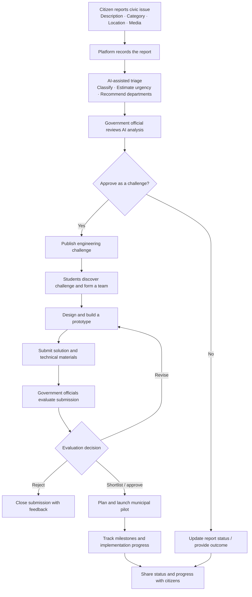
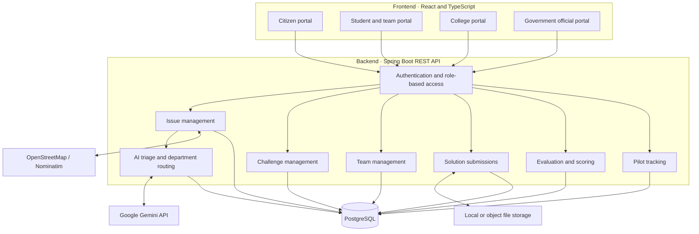

# Civic Innovate

**A smart-city civic innovation platform that connects citizens, engineering students, colleges, and government departments to solve real-world urban problems.**

Civic Innovate is designed to turn civic issue reports into structured engineering challenges. Citizens can report problems in their communities; AI-assisted triage can help classify and route those reports; students and college teams can develop prototypes; and government officials can review proposed solutions and track selected pilots.

> **Project status:** This repository contains a working development prototype. The architecture and roadmap describe the broader intended platform; not every capability in the plan should be assumed to be fully implemented or production-ready.

## The problem Civic Innovate addresses

Civic problems such as damaged roads, drainage failures, waste accumulation, and public-infrastructure issues are often reported through disconnected channels. At the same time, engineering students need opportunities to apply their skills to practical problems. Civic Innovate aims to connect these needs through one transparent workflow.

## How it is intended to work

The workflow connects a citizen's report to a potential engineering solution and, where approved, a municipal pilot:

1. **Citizen reports an issue** with a description, category, location, and supporting media.
2. **The platform records the report** and sends it for AI-assisted triage.
3. **AI-assisted triage analyses the report**, estimates urgency, identifies likely root causes, and recommends relevant engineering departments.
4. **A government official reviews the AI result** and decides whether the issue should become a public engineering challenge.
5. **Students discover the challenge**, form a team, and develop a practical solution or prototype.
6. **The team submits its solution** with the available technical materials and demonstration links.
7. **Government officials evaluate the submission** using criteria such as technical feasibility, cost-effectiveness, community impact, safety, and scalability. The proposal may be shortlisted, sent back for revision, or rejected.
8. **A selected solution may become a municipal pilot**, with implementation milestones and progress tracked for transparency.
9. **Citizens can follow issue status and progress** through the platform.

### Civic Innovate workflow

The diagram below describes the intended end-to-end process. Official review is included between AI triage and publication of a challenge; AI recommendations do not automatically approve a challenge or a pilot.



## High-level system architecture

This is the **target architecture described by the project plan**, not a claim that every integration or component is already complete in the current prototype.



## Main stakeholder groups

| Stakeholder | Intended role |
| --- | --- |
| Citizens | Report local issues and follow their progress. |
| Students | Explore challenges, form teams, and submit prototypes. |
| College administrators and faculty mentors | Support student participation, verify institutional details, and mentor teams. |
| Government officials | Review issue triage, publish challenges, evaluate solutions, and oversee pilots. |
| Platform administrators | Manage platform configuration, users, institutions, and system operations. |

Access to features is role-based. Users should only be able to perform actions permitted for their role.

## Technology direction

The project architecture is based on the following technologies:

- **Backend:** Java and Spring Boot, with Spring Security and Spring Data JPA
- **Frontend:** React, TypeScript, Vite, and Tailwind CSS
- **Database:** PostgreSQL
- **AI-assisted triage:** Google Gemini API, with a fallback strategy for cases where AI is unavailable
- **Maps and location:** Leaflet and OpenStreetMap
- **Authentication:** JWT-based authentication and role-based access control

See the project architecture and dependency files for the exact versions used by the current codebase.

## Repository structure

```text
civic-innovate/
├── backend/                 # Spring Boot application
├── frontend/                # React + TypeScript application
├── uploads/                 # Local uploaded files (not committed to Git)
├── API_DOCUMENTATION.md     # API reference
├── ARCHITECTURE_DECISIONS.md
├── DATABASE_DOCUMENTATION.md
├── DEPLOYMENT_GUIDE.md
├── PROJECT_MASTER_PLAN.md
├── PROJECT_PROGRESS.md
├── PROJECT_TASK_BOARD.md
├── TEST_REPORT.md
├── .env.example             # Placeholder environment-variable template
└── .gitignore
```

## Local development setup

### Prerequisites

Install the tools required by the current backend and frontend projects:

- Java Development Kit (use the version required by `backend/pom.xml`)
- Apache Maven
- Node.js and npm
- PostgreSQL

### 1. Clone the repository

```bash
git clone https://github.com/rtrokesh-hub/civic-innovate.git
cd civic-innovate
```

To work on the UI redesign branch:

```bash
git switch professional-ui-redesign
```

### 2. Configure PostgreSQL

Create a PostgreSQL database for the application. The current local configuration in `backend/src/main/resources/application.yml` uses the database name `civic_innovate_db` and connects to `localhost:5433`.

Make sure your local PostgreSQL service, port, database name, username, and password match your local configuration. Update the datasource settings in `application.yml` for your machine when needed. Do not commit personal database passwords or production credentials.

### 3. Configure environment variables

The backend expects a JWT signing secret through `CIVIC_JWT_SECRET`. Set a strong, randomly generated secret in your local environment before starting the backend.

In PowerShell, for the current terminal session:

```powershell
$env:CIVIC_JWT_SECRET = "<your-strong-random-secret>"
```

The Gemini API key is optional for local development if the application is configured to use its non-AI fallback when the key is absent:

```powershell
$env:GEMINI_API_KEY = "<your-gemini-api-key>"
```

The upload directory can optionally be changed with `APP_UPLOAD_DIR`. If it is not set, the application uses the `uploads` directory:

```powershell
$env:APP_UPLOAD_DIR = "uploads"
```

Keep real secrets in environment variables or a private local configuration file. **Never commit `.env` files, API keys, JWT secrets, database passwords, or user-uploaded files.** The committed `.env.example` contains placeholders only.

### 4. Start the backend

Open a terminal in the repository root:

```powershell
cd backend
mvn spring-boot:run
```

The current application configuration sets the backend port to `8080`.

### 5. Start the frontend

Open a second terminal in the repository root:

```powershell
cd frontend
npm install
npm run dev
```

Use the local development URL printed by Vite in the terminal.

## Documentation

The repository includes supporting project documents:

- `API_DOCUMENTATION.md` — backend API details
- `ARCHITECTURE_DECISIONS.md` — architecture and implementation decisions
- `DATABASE_DOCUMENTATION.md` — database design and persistence notes
- `DEPLOYMENT_GUIDE.md` — deployment guidance
- `PROJECT_MASTER_PLAN.md` — overall scope and implementation plan
- `PROJECT_PROGRESS.md` and `PROJECT_TASK_BOARD.md` — progress and task tracking
- `TEST_REPORT.md` — recorded test results

Refer to these files for more detailed, implementation-specific information.

## Security and privacy notes

- Keep JWT signing secrets, Gemini API keys, and database credentials out of source control.
- Do not commit the `uploads/` directory or real user-submitted media.
- Keep authorization checks on the backend; hiding a frontend control is not a security boundary.
- Validate uploaded files and enforce appropriate size and type restrictions.
- Protect personally identifiable information and precise location data when displaying public issue information.

## Current branches

- **`main`** — backup of the original working prototype before the UI redesign.
- **`professional-ui-redesign`** — separate branch for professional UI improvements.

The redesign should preserve existing backend behavior, API contracts, authentication, authorization, database behavior, and application features unless a change is explicitly intended and reviewed.

## Contributing

Before making changes, check the project task board and relevant documentation. Keep changes focused, test affected functionality, and update documentation when APIs, configuration, or behavior changes.

For UI work, verify that all existing user roles and workflows continue to function after the visual changes.
